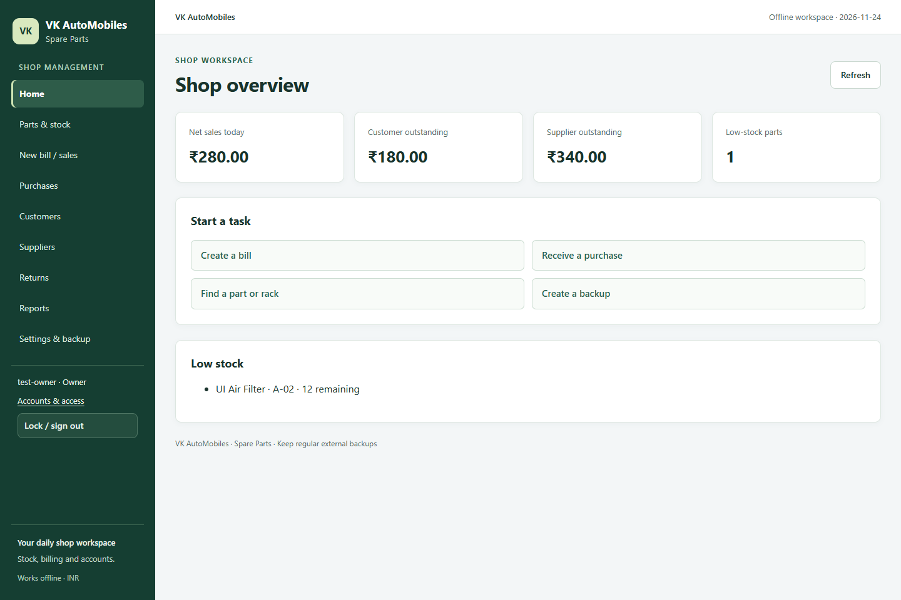

# VK AutoMobiles · Spare Parts

[](https://github.com/Nihadk117/vk-automobiles/actions/workflows/ci.yml)

Offline inventory and billing for a single-counter auto-spares shop in Kerala, India. Built with **Next.js, React, TypeScript and SQLite**, with owner/staff access, transactional stock and credit workflows, backup recovery, automated testing and a one-click Windows launcher.

This project supports both a real shop pilot and an engineering portfolio. Its learning focus is relational data modeling, transaction integrity, permissions, regression testing, cross-platform CI and repeatable Windows delivery. Physical shop-machine and printer acceptance remain pending; a hosted demonstration has not been deployed.



[View billing and A4 receipt](docs/screenshots/billing.png). Screenshots use fictional parts, customers, suppliers and transactions from the automated UI review; the repository includes no live shop database or account credentials.

Shop profile: Edavannapara, Malappuram · PINCODE: 673645 · Phone: +917025724642. The saved profile appears in receipt headers; edit it under Settings & backup.

Local single-computer retail software for a spare-parts shop in Kerala. Next.js App Router, React, TypeScript and SQLite. Core workflows are implemented for a shop pilot; the actual printer and shop-machine installation still need operational acceptance.

## Run this checkout

After building, run `npm run launcher:local` on Windows, then double-click `release/Local launcher/VK Automobiles.exe`. It starts the backend without a console, waits for database health and opens **http://127.0.0.1:3000/shop/home** in the default browser. Repeated clicks reuse the verified running instance. Closing the browser leaves the backend running; after restarting Windows, click the launcher again. Checkout records remain in `data/shop.sqlite`. Browser/launcher tests use isolated databases; no sample records are inserted into the shop.

The local launcher folder contains **Stop shop**, **Restart shop** and **Status shop** CMD helpers. Installed packages provide equivalent shortcuts in their **Maintenance** folder. Save work and download a backup before stopping/updating. An older manually started console must be stopped with Ctrl+C once before switching to the new launcher. The developer console launcher `scripts/start-shop.cmd` remains available for debugging.

The first visit asks you to create an owner username and a password of at least 12 characters. No default credentials are shipped. Save the one-time recovery code privately. After signing in, use **Accounts & access** to create staff, reset staff passwords, disable accounts and review the latest 200 activity events. Staff bill at saved selling prices; owner access is required for price overrides, inventory changes, opening debts, contact edits, returns, cancellations, backups and user administration. Both roles can change their own passwords. Sessions expire after 15 minutes without activity or eight hours overall. **Lock / sign out** ends the current session.

Version 0.2.2 stabilizes username validation, logout with restricted browser storage, slow automatic locking, backup-storage failures and Unicode Windows paths. A backup problem is shown to the owner while stock/billing screens remain available; fix the storage issue and create a new backup promptly. During automatic locking, the workspace is hidden and disabled until the login page opens. Saved bill drafts and payment-correction workflows remain deferred.

## Available workflows

- Parts: add/edit, part numbers, comma-separated vehicle compatibility backed by model links, one rack, opening counts, optional purchase cost, low-stock labels, duplicate warnings and stock correction history.
- Purchases: suppliers, invoice references/dates, received stock, cash/UPI settlement and supplier credit.
- Sales: live part search by name, brand, vehicle, part number or rack; click a matching result to add it, or press Enter for a unique match. Includes actual line prices, available-stock enforcement, mixed cash/UPI, named-customer credit and A4 receipt/reprint.
- Accounts: customer/supplier opening debts, oldest-first payment allocation, balances, statements and contact editing.
- Returns: original-bill quantities and prices, saleable/damaged classification, debt reduction, exact refunds, exchanges through a new sale.
- Corrections: reasoned stock recounts, optimistic revision checks and restricted document cancellation with stock/payment reversals.
- Reports: dated sales/returns/cancellations/purchases, actual cash/UPI flows, current stock and outstanding accounts, CSV/JSON export.
- Protection: transaction-based financial posting, persistent retry keys, consistent daily/manual SQLite snapshots, download and validated transactional restore with a recovery snapshot.
- Delivery: Windows package with bundled Node runtime, per-user installer and desktop shortcut; CI and Windows-release workflow source.

Read **[the operating guide](docs/shop-guide.md)** for setup, workflows, backup handling and cutover. See **[architecture](docs/architecture.md)** and **[verification status](docs/foundation-status.md)** for implementation details and limits.

## Windows package

Run `npm run build`, then `npm run package:windows` on Windows. The ZIP appears under `release/`. Extract it fully and run `Install.cmd`. This installs for the current user and creates a desktop shortcut; no separate npm/Node installation is needed. Alternatively launch `App/Launch.cmd` from the extracted package.

Packaged records live at `%LOCALAPPDATA%/VKAutomobiles/data/shop.sqlite`, outside the versioned app directory. No database, backups or `.env` files are shipped. The desktop shortcut targets a GUI executable, not a console script. No Windows startup task or service is installed. To move records from this checkout, download a SQLite backup and restore it in the installed app. Before an update, save work, download a backup, use **Stop shop**, install the new package, then launch the new shortcut. Running older versions are not silently replaced.

Launcher state and diagnostic logs live in the `launcher` folder beside the selected database. Logs rotate on backend start above 2 MB, retaining one previous copy. A mutex serializes starts, and process identity, start time, runtime path, command line and health instance are checked before reuse or stop. An occupied foreign port is never reused or killed. Stop can interrupt in-flight saves; review bill history before retrying an interrupted transaction. Stop does not sign out persisted sessions: use **Lock / sign out** when handing the computer to someone else.

## Development and checks

Use a supported Node LTS release and npm. In PowerShell, if Node isn't on PATH: `$env:Path = 'C:\Program Files\nodejs;' + $env:Path`.

```text
npm ci
npm run dev
npm run lint
npm run typecheck
npm test
npm run build
npm run test:e2e
npm run test:ui
npm run test:auth
npm run test:launcher
npm start
```

Local browser tests use installed Google Chrome; CI uses Playwright Chromium. Tests run the standalone production server on 3100, exercise a separate database and create fictional records. Build output includes static assets. Native SQLite binaries are specific to the build OS/architecture and Node runtime.

The UI review runs separately on port 3110 with fresh fictional records. It checks all nine pages at desktop/mobile widths, button hover/press/focus/disabled feedback, saving states, and the A4 receipt profile. Screenshots, a sample PDF and the report are saved under `qa-artifacts/ui-polish/`.

To watch the expanded acceptance tests in a visible Chrome window, run `npx playwright install ffmpeg` once for recording support, then `npm run test:watch-shop`. This uses a fresh fictional database, adds labelled test steps, and saves videos, screenshots, traces and an HTML report under `qa-artifacts/watched/`. Do not click in the automated window while it runs. For unattended execution, set `SHOP_QA_HEADLESS=1` and `SHOP_QA_SLOW_MS=0`. CI includes the same acceptance suite and retains its report.

`SHOP_BUILD_DIR=.next-qa` allows a separate QA build without replacing the running application's `.next` files. Use it consistently for build and test commands. `scripts/qa-snapshot.mjs before` / `after` compares logical shop records on port 3000 without writing business records. The 22 November audit summary is in `qa-artifacts/audit-summary.json` with the original failures retained separately from the verified results.

Configuration: `SHOP_DATABASE_PATH` selects the database, `PORT` defaults to 3000, `SHOP_ORIGIN` sets the exact permitted origin for writes (default `http://127.0.0.1:<PORT>`). The local launcher binds only to 127.0.0.1. No external fonts or mandatory online services are used.

## Boundaries

Supplier returns, GST features, multi-shop/staff operation, online sync and advanced profit/valuation are deferred. This release uses local password authentication and remains designed for one shop computer bound to loopback. History currently loads as local snapshots; large deployments need paginated APIs and a central database design. A staged rack/batch import wizard is not implemented; opening stock is entered and reviewed per part.

Repository: [Nihadk117/vk-automobiles](https://github.com/Nihadk117/vk-automobiles). Check the actual run outcomes under [GitHub Actions](https://github.com/Nihadk117/vk-automobiles/actions); workflow files alone do not prove a passing run. CI and Windows release jobs gate packaging on dependency audit, lint, TypeScript and the relevant application/browser/launcher checks. No hosted portfolio demo has been deployed. A public demo must use fictional data, authentication and separate storage. Physical printer and clean shop-machine acceptance remain necessary before live use. Dependency findings and their resolution are recorded in the verification status.
