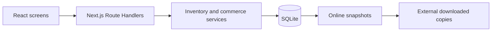

# Architecture and transaction design

Next.js App Router provides the React UI and Node Route Handlers. SQLite lives outside release assets. Inventory and commerce modules enforce rules independently of the HTTP layer. All money is integer paise. The local launcher binds loopback; the planned fictional hosted demo must add authentication and data isolation before public exposure.

Schema migrations preserve the original inventory. Stock is the sum of immutable movements, not a directly edited part quantity. Vehicle models have a many-to-many link table; the UI accepts comma-separated shop-confirmed models. Customer and supplier debts derive from posted documents less payment allocations and original-bill return debt reductions. Opening debts are separately identifiable documents.

Migration four adds local users, sessions, failure counters, recovery configuration and activity records without changing business tables. Passwords and owner recovery codes use individually salted scrypt hashes (N=32768, r=8, p=3); random session secrets are stored only as SHA-256 hashes. Port-specific HttpOnly, SameSite=Strict cookies carry the secret. Secure cookies are enabled for an explicitly configured HTTPS origin; the shipped loopback HTTP launcher uses HTTP cookies. Sessions have 15-minute inactivity and eight-hour absolute limits. Failed login/recovery/password attempts use persisted per-account and global limits. No default account or external identity service exists.

Server-rendered shop pages require a valid session, and every business API independently checks it. Stock edits, backups/restoration and user management require owner access. Commerce commands authorize staff actions before entering the transaction; sales price overrides require the owner. Mutations recheck sessions after reading asynchronous request bodies, and business audit writes share the business transaction. Financial retries retain one activity event per request key. Owner activity lists show the latest 200 events. Login and account forms use POST and disable credential entry until hydration, avoiding native GET submissions.

Full SQLite snapshots include authentication hashes and must be treated as confidential. Business restoration accepts version-three/four backups, preserves current authentication tables, audit and migration version, and revokes every current session. It never imports another installation's users or sessions. Local app login does not encrypt SQLite or constrain a Windows administrator. A shared business snapshot remains visible to authorized staff for routine transactions; hiding the reports page is not a separate confidentiality boundary for values already present in those workflows.

Sales/purchases snapshot descriptions, manufacturer numbers and actual line prices. Payments store direction and cash/UPI separately. Oldest-first allocations make later collections traceable. Returns refer to original sale lines and preserve saleable/damaged classification. Cancellation is an explicit recorded reversal and cannot bypass later payments/returns.

Every financial command executes in a BEGIN IMMEDIATE transaction. That covers document, stock, payment, allocation and idempotency writes. A request UUID plus payload fingerprint returns the previous result on exact retry and rejects changed details with the same key. Inventory edits and stock recounts use revisions to reject stale writes. Creation of catalogue parts currently has click suppression and duplicate warnings but no persisted request key; after an uncertain part save, review the catalogue before retrying.

Backups use SQLite's online backup API and are published only after completion. Restore validates a staging file and copies table contents into the existing schema in one transaction, maintaining an automatic recovery copy. A process-wide maintenance flag blocks requests while restoring. This design is specifically single-process/single-PC; a future multi-instance deployment needs coordinated maintenance and a central database.

The UI currently loads full local snapshots for the small shop. Growth work includes paginated history APIs and measured query optimisation. PostgreSQL migration, tenant isolation and distributed/offline sync are separate designs, not a switch or a claimed implemented capability.

GitHub workflow source runs type checks, tests, production builds and browser workflows on Windows/Linux. A release workflow builds a Windows ZIP with a bundled Node runtime and flattened dependencies. No GitHub remote has been configured and no hosted CD execution has occurred.

The Windows GUI executable is a small .NET Framework entry point that invokes a hidden PowerShell controller. The controller serializes starts with a named mutex, keeps per-database instance state and launches Node through a short helper with detached execution, hidden windows and real log-file handles. Backend logging is independent of the GUI/controller lifetime. Health responses expose an application identifier, release version and random instance identifier; this identifier is a readiness/ownership marker, not an authentication secret. The database location is never exposed by the health response. Stop validates PID/start time, executable path and exact server command line before terminating the managed process. No background service or logon task is installed. Installed updates get separate version directories and require stopping the old instance explicitly.
